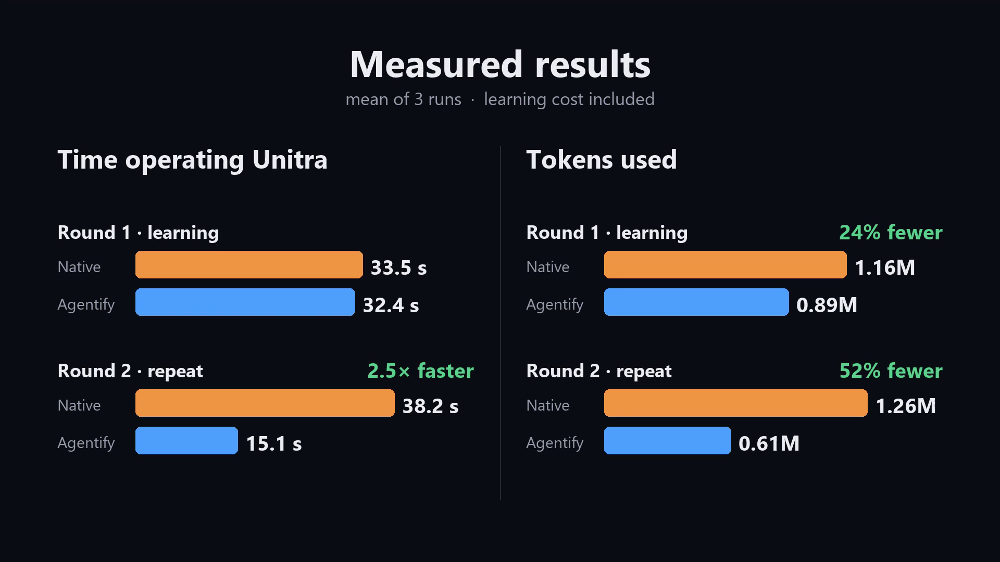
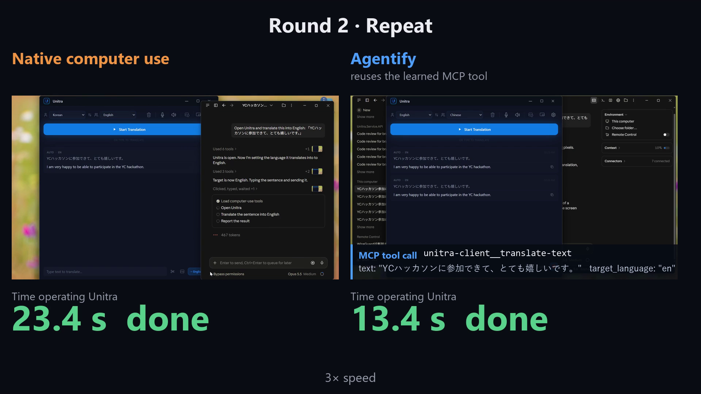

# Agentify

> Give an AI agent any software. It learns how to use it, remembers what works, and gets better with every task.

[](https://github.com/nikmomo/agentify/actions/workflows/ci.yml)
[](LICENSE)


Agentify is an [MCP](https://modelcontextprotocol.io) server that turns existing Windows desktop
apps into MCP tools. It needs no API, plugin, or source code for the app.

An agent calls `explore_app(app, goal)`. An Explorer sub-agent (Claude Code in headless mode)
works the app through its accessibility tree. Agentify records and verifies what the Explorer
did, compiles it into a parameterized workflow, replays that workflow, and only then publishes it
as a tool, for example:

```
notepad__save-note(text, path)
```

Any MCP host can then call that tool. The call replays deterministically, with **no LLM in the
loop**, and returns `verified` plus any outputs the workflow declares.

**Core loop:** Explore → Verify → Compile → Replay-verify → Publish → Use → (Improve)

## Demo: Agentify vs native computer use

Same model (Opus 5.5 Medium in Claude Desktop) and same prompt on both sides: open Unitra, a
desktop translation app, and translate a Japanese sentence into English. Round 1 includes
Agentify's one-time learning; round 2 repeats the task with the learned MCP tool.



<sub>Mean of 3 runs. Time is time spent operating the app; tokens include the Explorer sub-agent.</sub>



## Why

Computer-use agents re-plan every task from screenshots, every time. Agentify pays the
exploration cost once and then reuses the result:

| | Computer use | Agentify |
|---|---|---|
| Per call | screenshots + LLM reasoning per step | one MCP tool call, deterministic replay |
| Selectors | pixel coordinates | UI Automation (AutomationId, role + name, label) |
| Success signal | the model's own judgement | postconditions checked against live UI state |
| Reuse | none | versioned workflow, shared by every agent that connects |

The gain grows with the number of UI steps and repetitions. Short tasks that a few keyboard
shortcuts already solve gain little.

## Requirements

- Windows 11 with an interactive, unlocked desktop (UI Automation needs a real session)
- Python 3.12 and [uv](https://docs.astral.sh/uv/)
- [Microsoft WinApp CLI](https://github.com/microsoft/WinAppCli) (verified against 0.7.1)
- [Claude Code](https://code.claude.com) CLI, signed in, for `explore_app`. The Explorer uses
  the CLI's own sign-in; API keys in the environment are removed for the sub-agent.
- Any MCP host to use the generated tools (Claude Code, Claude Desktop, Cursor, ...)

`scripts/setup_env.ps1` installs uv, Python 3.12, and WinApp CLI with winget.
`scripts/check_env.ps1` and `uv run agentify doctor` verify the toolchain.

## Quick start

```powershell
git clone https://github.com/nikmomo/agentify.git
cd agentify
.\scripts\setup_env.ps1      # optional: uv, Python 3.12, WinApp CLI via winget
uv sync
uv run agentify doctor
```

Register the learning server with your MCP host. `mcp-config` prints a ready-to-paste
`mcpServers` entry and the matching `claude mcp add` command:

```powershell
uv run agentify mcp-config --data-dir data
```

Then ask your agent, for example:

> Use Agentify to learn how to write a note in Notepad and save it to a file, as a capability
> with the inputs `text` and `path`.

The agent calls `explore_app`. When it finishes, a new tool such as `notepad__save-note` appears
in the tool list, and any later session can call it directly.

### Serve one app as its own MCP service

To give other agents only an app's learned tools (no learning tools, plain names), run a
per-app service on the same store:

```powershell
uv run agentify mcp-config --app notepad --data-dir data
```

It picks up newly learned tools without reconnecting (`tools/list_changed`).

### Inspect what was generated

```powershell
uv run agentify catalog --data-dir data            # Markdown
uv run agentify catalog --data-dir data --serve    # live page on http://127.0.0.1:8765
```

### Read-only probes

```powershell
uv run agentify apps
uv run agentify inspect <process:hwnd>
uv run agentify find <process:hwnd> --role Button --name Save
uv run agentify value <process:hwnd> --role ComboBox --name Colour
```

## MCP tools

Learning server (`agentify serve`):

| Tool | Purpose |
|---|---|
| `explore_app(app, goal)` | Explorer sub-agent discovers, verifies, and publishes a capability |
| `list_capabilities(app?)` / `execute_capability(id, arguments)` | list and run published capabilities |
| `open_app(app)` | start an app from its Start-menu shortcut |
| `list_apps`, `inspect_app` | discover running windows and their accessibility outline |
| `start_learning`, `perform_action`, `verify_outcome`, `learn_skill`, `abandon_learning` | the manual learning path, if the host agent explores by itself |
| `list_skills`, `run_skill`, `update_skill`, `get_skill`, `get_execution` | manage versions and evidence |
| `<app_key>__<skill_id>`, `<app_key>__<skill_id>_batch` | one generated tool (plus a batch variant) per published capability |

`improve_capability` (the Explorer repairs a failing capability and Agentify re-verifies it) is
implemented but off by default; enable it with `AGENTIFY_ENABLE_IMPROVE_TOOL=true`.

The full specification is in [`docs/MCP_API.md`](docs/MCP_API.md).

## How it works

```
 MCP host agent ──► Agentify MCP server ──► Explorer sub-agent (claude -p, scoped to one app)
                         │                          │
                         │                          ▼
                         │                 recorded, bounded exploration (trace)
                         ▼                          │
                 Workflow IR (YAML) ◄── compile ◄───┘
                         │
                 replay-verify (other values, then yours)
                         │
                         ▼
                 generated MCP tool ──► deterministic replay over UI Automation
```

- **Adapters** (`src/agentify/adapters/`): a platform adapter contract, with a Windows adapter over
  WinApp CLI and an in-process UI Automation fast path.
- **Workflow IR** (`src/agentify/workflows/`): typed steps with semantic selectors, `{{param}}`
  substitution (no `eval`), `value_map`, checks, and outputs.
- **Learning** (`src/agentify/learning/`): trace → parameterized workflow.
- **Skills and storage** (`src/agentify/skills/`, `src/agentify/storage/`): versions, promotion,
  run statistics; SQLite plus one YAML file per version.

Design documents: [`ARCHITECTURE`](docs/ARCHITECTURE.md), [`WORKFLOW_IR`](docs/WORKFLOW_IR.md),
[`ADAPTER_CONTRACT`](docs/ADAPTER_CONTRACT.md), [`SKILL_LIFECYCLE`](docs/SKILL_LIFECYCLE.md),
[`SECURITY`](docs/SECURITY.md).

## Configuration

Settings come from the environment or a `.env` file; copy [`.env.example`](.env.example). The most
useful ones:

| Variable | Default | Meaning |
|---|---|---|
| `AGENTIFY_DATA_DIR` | `./data` | skill store and evidence |
| `AGENTIFY_EXPLORER_MODEL` / `AGENTIFY_EXPLORER_EFFORT` | `claude-opus-5-5` / `medium` | Explorer sub-agent |
| `AGENTIFY_ALLOWED_WINDOWS` | empty (all) | restrict which windows are visible and actionable |
| `AGENTIFY_APPROVAL_THRESHOLD` | `data_write` | risk level that requires explicit approval |
| `AGENTIFY_SECRET_NAMES` / `AGENTIFY_SECRETS_FILE` | empty / `.env` | allowed `${secret:NAME}` references |
| `AGENTIFY_UIA_FAST_PATH` | `true` | in-process UI Automation for hot operations |
| `AGENTIFY_AUTO_IMPROVE`, `AGENTIFY_ENABLE_IMPROVE_TOOL` | `false` | self-repair loop (experimental) |

## Safety

Agentify sends real input to real applications. By design:

- Actions are restricted to the attached app (checked by owning process, so popups work).
- A keyboard deny list blocks system combinations such as `alt+f4`, `win+*`, `ctrl+alt+del`.
- Actions at or above `AGENTIFY_APPROVAL_THRESHOLD` need explicit approval through the MCP host.
- Explorations and replays have hard caps on actions and wall-clock time.
- UI text is treated as untrusted data, never as instructions.
- Secrets are passed as `${secret:NAME}` references; values never appear in workflows, traces, or
  results. Typed keys are redacted in logs.
- Runtime data stays in the git-ignored `data/` directory.

See [`docs/SECURITY.md`](docs/SECURITY.md). Use `AGENTIFY_ALLOWED_WINDOWS` when other windows hold
data you care about.

## Status and limitations

Agentify is an early MVP, built for the YC "Make Something Agents Want" hackathon
(October 17–18, 2026).

- **Windows only.** Browser, macOS, and Linux adapters are defined as interfaces and raise
  `UnsupportedPlatformError`.
- **Supported means tested.** Tested end to end on Windows 11 Notepad, a Tauri/WebView2 desktop
  app, and the WinForms fixture apps in `tests/fixtures/`. Other apps work only as far as they
  expose a usable UI Automation tree.
- Discovery uses an LLM (Claude Code); replay does not.
- Self-repair (`improve_capability`, automatic improvement of failed runs) works in tests but is
  off by default.

## Development

```powershell
uv sync
.\scripts\dev.ps1 check              # ruff, format check, mypy (strict), unit tests: what CI runs
uv run pytest -m integration -v      # real WinApp CLI vs the WinForms fixture; unlocked desktop required
.\scripts\build_fixture.ps1          # build the fixture apps used by the integration tests
```

Contributor and coding-agent guidelines are in [`AGENTS.md`](AGENTS.md).

## Repository layout

```
src/agentify/      the package: adapters, workflows, learning, skills, storage, explorer, mcp, cli
tests/             unit tests (FakeAdapter, recorded CLI JSON) and real-desktop integration tests
docs/              specifications: architecture, MCP API, adapter contract, workflow IR, lifecycle, security
scripts/           environment setup and dev helpers (PowerShell)
```

## License

[MIT](LICENSE) © Zhen Zhang
