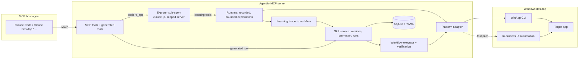

# Architecture

## Overview

Agentify is a local MCP server (Python, stdio). An MCP host agent asks it to learn a task in a
desktop app; an Explorer sub-agent works the app through a platform adapter; Agentify records the
exploration, compiles it into a parameterized workflow, verifies it by replaying it, and publishes
it as a generated MCP tool. Calling that tool replays the workflow without any model call.

## Modules (`src/agentify/`)

| Module | Role |
|---|---|
| `adapters/base/` | `PlatformAdapter` protocol, typed models (`Selector`, `Element`, `Observation`, `Action`, `ActionResult`, `RiskLevel`), typed errors, selector resolution, keyboard deny list, window allowlist |
| `adapters/windows/` | `WinAppCliAdapter`: `winapp ui ... --json` subprocesses, JSON parsing, error mapping, an in-process UI Automation fast path (`uia.py`), and opening apps from their Start-menu shortcut (`launch.py`) |
| `adapters/fake/` | in-memory `FakeAdapter` and scenarios, for unit tests only |
| `adapters/unsupported.py` | browser / macOS / Linux placeholders that raise `UnsupportedPlatformError` |
| `runtime/` | explorations: bounded action execution, risk approval, trace capture |
| `learning/` | compile a verified trace into a Workflow: inputs, bindings, `value_map`, checks, outputs |
| `workflows/` | Workflow IR models, YAML loader, `{{param}}` templating, executor, verification |
| `skills/` | skill versions, promotion policy, runs and statistics |
| `storage/` | SQLite metadata and evidence, one YAML file per skill version |
| `explorer/` | the Explorer sub-agent (`claude -p`) and its discovery and repair prompts |
| `mcp/` | MCP server: stable tools, capability tools, one generated tool per skill, per-app service |
| `catalog.py`, `catalog_live.py` | `agentify catalog`: the generated services as an MCP client sees them |
| `secrets.py` | `${secret:NAME}` references |
| `config.py`, `observability/`, `cli.py` | settings, JSON-lines logging, the `agentify` CLI |

## Key flows

### Discovery (`explore_app`)

1. The host calls `explore_app(app, goal)`.
2. Agentify starts the Explorer (`claude -p`, OAuth) against a scoped server
   (`agentify serve --explore-scope <app>`) that exposes only the learning tools for that app.
3. The Explorer uses `start_learning`, `perform_action` (batched), and `verify_outcome`, then
   `learn_skill`. Every action goes through the runtime: risk check, action cap, trace.
4. `learning` compiles the trace into Workflow v1.
5. Before publishing, Agentify replays the workflow: with other values for inputs that have a
   closed set of choices, then with the learned values. Only a verified version is served (the replay is
   skipped, and recorded as skipped, when the goal state already holds).
6. The generated tool is registered and `tools/list_changed` is announced.

### Replay (generated tool)

1. The skill service loads the served version and validates the arguments.
2. The executor resolves each step's selector (automation id, then slug, then role + name or
   label) and performs the action through the adapter.
3. Postconditions are checked against live UI state; declared outputs are read.
4. The run is recorded; enough verified runs with distinct arguments promote a candidate to
   `active`.

## Dependency rules

- `mcp` uses `runtime`, `skills`, `storage`, `explorer`. Nothing imports `mcp`.
- `learning` and `workflows` never import an adapter implementation.
- `adapters/windows` depends only on `adapters/base`.
- No module contains application-specific logic. Everything app-specific is learned and lives in
  the data directory.

## Process model

One stdio process per server. WinApp CLI calls are synchronous subprocesses with timeouts; MCP
handlers are `async` and offload them to threads, and a UI lock serializes tool calls that drive
the desktop. Logs go to stderr because stdout carries MCP.
