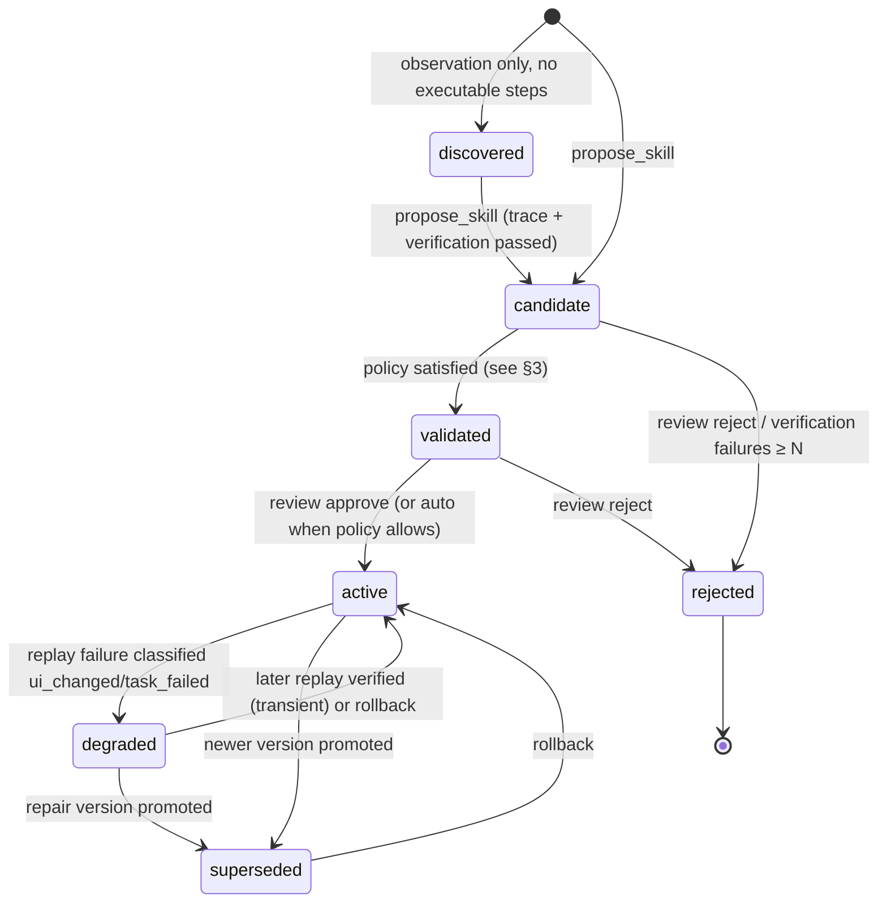

# Skill Lifecycle and Learning Design

> **MVP as implemented (2026-10-17):** discover / learn / update only. Code: `src/agentify/skills/service.py`.
> - **Learn:** `learn_skill` creates v1 as `candidate`; the learning run counts as one verified run.
> - **Promotion:** `candidate` becomes `active` automatically after at least 2 verified runs and, for skills with inputs, at least `AGENTIFY_PROMOTE_AFTER_VERIFIED_PARAM_SETS` (default 2) distinct verified parameter sets. The previous active version becomes `superseded`. A single run never activates a skill.
> - **Update with an execution:** v(N+1) is re-learned as a `candidate`, and the active version keeps serving until v(N+1) is promoted. Run the candidate with `run_skill(version=N+1)`.
> - **Update without an execution:** a metadata change (name, description, input descriptions). v(N+1) inherits the base version's status and run statistics, and the base becomes `superseded`. Input names and types cannot change this way.
> - **Not implemented:** `degraded`, repair, regression replay, rollback, `review_skill`, and failure classification beyond `bad_parameters`, `selector_unresolved`, `action_failed`, `timeout`, `permission_denied`, `verification_failed`, and `limit_exceeded`.

## 1. Three things that are not the same

| Artifact | What it is | Where it lives |
|---|---|---|
| **Learning evidence** | Traces, observations, screenshots, verification results, failure explanations, repair attempts | `executions`, `steps`, `verifications`, `evidence` tables; `data/traces/*.jsonl` |
| **Executable workflow** | A versioned Workflow IR document | `skill_versions` row + `data/skills/<app_key>/<skill_id>/v<N>.yaml` |
| **Skill metadata** | Identity, description, app, input schema, risk, lifecycle status, active version, verification history | `skills` row |

Evidence never modifies a workflow. Only `propose_skill`, `propose_repair`, and `review_skill` create or change versions.

## 2. States

Per-version status lives on `skill_versions`; the skill's headline status is that of its `active_version` (or the newest candidate if none is active).

## 3. Promotion policy (configurable)

| Transition | Requirement |
|---|---|
| `candidate → validated` | ≥ 2 verified executions of this version with **distinct parameter sets** (or ≥ 1 if `inputs` is empty), 0 unexplained failures, all verification by observable state (no `manual` verifier) |
| `validated → active` | explicit `review_skill(approve)` by the host/user. Env `AGENTIFY_AUTO_ACTIVATE=true` allows auto-activation for demo speed; the record notes it. |
| `active → degraded` | one replay failure classified `ui_changed` or `task_failed` (not `timeout`, `bad_parameters`, `permission_denied`) |
| `candidate(repair) → active` | the repair version passes verification for the failed parameter set **and** passes regression replay of every previously verified parameter set of the superseded version (bounded to the last 3), then `review_skill(approve)` |
| any → `rollback` | `review_skill(rollback)` reactivates the previous `superseded` version; the current one becomes `rejected` with reason |

A single successful execution never produces an `active` skill.

## 4. Flow

### Exploration
No applicable active skill → host explores through `inspect_app` / `perform_action` within an `explore` execution. All actions bounded and recorded.

### Verification
`verify_outcome` re-reads live state. Accepted verifier types are listed in `MCP_API.md`. "The click returned ok" is not verification.

### Candidate extraction
`propose_skill` with bindings → Workflow v1 (`candidate`). Extraction rules:
- `locate`/`read_value`/`screenshot` steps are dropped from `steps` (kept in evidence); `wait_for` steps are kept.
- Each kept step stores the selector that actually resolved plus a `(role, name)` fallback captured from the observed element.
- Literals bound to inputs are replaced with `{{input}}`.
- The verification expectation passed to `verify_outcome` becomes the workflow's `verification` (templated where its `expected` equals a bound literal).

### Reuse
`execute_skill` → validate params → preconditions → replay → verification → `executions` row with `mode=replay`. Candidates can be replayed with `allow_candidate=true` (this is how they accrue verified runs).

### Feedback
Every execution writes: outcome, duration, action count, `resolved_by` per step, fallback usage, failure category, observation snapshot on failure. Nothing here edits the workflow.

### Failure classification

| Category | Signal |
|---|---|
| `ui_changed` | window present, selector unresolved by all strategies, or resolved element lacks the needed pattern; a `dry_run` reproduces it |
| `timeout` | element appeared after the deadline or app unresponsive; `dry_run` later succeeds |
| `precondition_failed` | a precondition is false before any step runs |
| `bad_parameters` | input validation or enum mismatch |
| `permission_denied` | approval required / outside window / `no_interactive_desktop` / UIPI |
| `task_failed` | all steps ran, verification false, UI structure unchanged |

### Repair (experimental, off by default)
1. Replay stops at the failed step (no further input) and records the failure category.
2. With `AGENTIFY_ENABLE_IMPROVE_TOOL=true`, the host can call `improve_capability(problem, failing_arguments)`; with `AGENTIFY_AUTO_IMPROVE=true`, a repairable failure of a skill below `data_write` risk is handed over at once.
3. The Explorer re-explores the app and creates v(N+1).
4. Agentify replays v(N+1), including with the failing arguments, before it serves; vN stays stored.

## 5. Matching a request to a skill

MVP: the host agent reads `list_skills` (names, descriptions, inputs) and chooses. The runtime does not do semantic matching. P1: simple lexical ranking over name/description for `list_skills(query=...)`.

